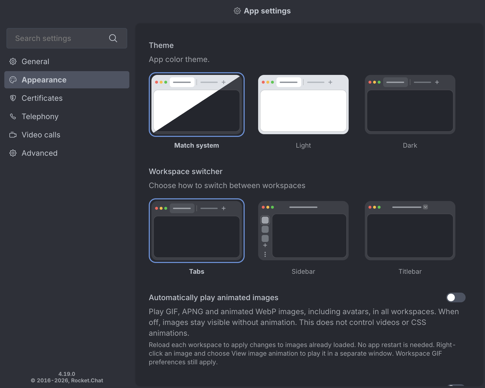

# Animated image playback

Open **Settings → Appearance → Automatically play animated images** to
control raster image animation in all desktop workspaces. The default is on.
The preference is saved across app restarts. Turning it on allows normal
workspace behavior, including the workspace's own GIF preference.



When off, supported images stay visible without animation. GIF, APNG and
animated WebP are verified by the bundled rendering check, including an
extensionless avatar URL. The policy operates on decoded images, so it does
not depend on a URL ending in `.gif`. Videos, CSS animations and SVG
animations are outside this control's tested scope.

Reload each workspace after changing the preference to update images that
were already loaded. No application restart is required. This follows
[Electron's image policy limitation](https://www.electronjs.org/docs/latest/api/web-contents#contentssetimageanimationpolicypolicy).
The app sets the initial policy before a workspace loads, and follows
preference changes for subsequently loaded images. It does not automatically
reload a workspace or rewrite images in the web client's DOM.

Right-click an HTTP(S) image and choose **View image animation** to play that
image in a separate window. The window uses the workspace's session and
referrer for authenticated image requests. Scripts, Node integration,
popups and user navigation are disabled. Closing the viewer leaves the
workspace's animation preference unchanged. For data/blob images, enable
playback and reload the workspace instead.

## Existing preferences

The web client's [Autoplay GIFs](https://docs.rocket.chat/docs/accessibility-and-appearance)
setting is useful for its interactive GIF controls. The desktop setting adds
a browser image policy across all workspaces and the verified raster image
formats, including avatars. A desktop policy can also stop a GIF that the
workspace would otherwise play on interaction; use the separate viewer in
that case.

[Auto Load Images and Collapse Embedded Media](https://docs.rocket.chat/accounts)
change loading or visibility. They do not provide this combination of visible
still images and a desktop-wide animation policy. CSS reduced-motion media
queries are not a substitute for controlling raster image decoding. This
preference is explicit and preserves the existing default regardless of OS
motion settings.

## Reproduce rendering checks and performance comparison

From the repository root after `yarn install`, run:

```sh
yarn electron scripts/benchmark-image-animation.ts --output /tmp/image-animation.json
```

Use `--verify-only` to run just the rendering checks. Add Chromium's
`--force-prefers-reduced-motion` switch before the script path to check the
reduced-motion case.

The local fixture scene contains 48 avatars at 48 × 48 and six inline images
at 192 × 192, using distinct URLs split equally among GIF, APNG and WebP.
Each animated fixture contains twelve 96 × 96 frames at 80 ms per frame.
Three rounds compare the current autoplay policy, disabled playback, and a
static PNG control. Each condition warms up for three seconds, then takes
60 samples at 250 ms intervals. The second round reverses the order.

The window stays visible above other windows. Frame captures before and
after sampling assert that the autoplay condition is actually animating and
the disabled/static conditions are still. Frame captures are outside the
CPU sampling interval. The checks also verify that existing animations
require a reload and that re-enabling playback works after reloading.

The JSON records raw samples, per-round means, Electron/Chromium versions,
CPU model and GPU configuration. CPU values come from
[`app.getAppMetrics()`](https://www.electronjs.org/docs/latest/api/app#appgetappmetrics)
and retain Electron's reported units. GPU-process CPU is CPU time consumed
by that process, not GPU hardware utilization. These synthetic measurements
do not establish whole-app, battery-life or real-channel savings. Run on the
target OS and hardware before generalizing the results.

## Measured comparison

The [recorded benchmark](performance/animated-image-playback.json) contains
all 540 samples from a macOS run on an Apple M4, using Electron 43.8.1 with
GPU compositing enabled. Means of the 180 raw samples for each condition:

| CPU metric (Electron-reported percent) | Autoplay on | Playback off | Static control |
| --- | ---: | ---: | ---: |
| Renderer | 0.5235% | 0.0069% | 0.0122% |
| GPU process | 1.2241% | 0.0065% | 0.0040% |

The limitations above apply to these numbers. They compare the `animate`
and `noAnimation` policies on the fixture scene, rather than two full app
versions running a live workspace.
